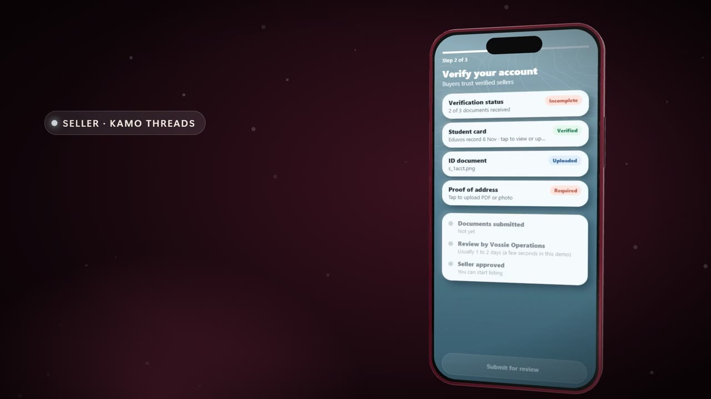
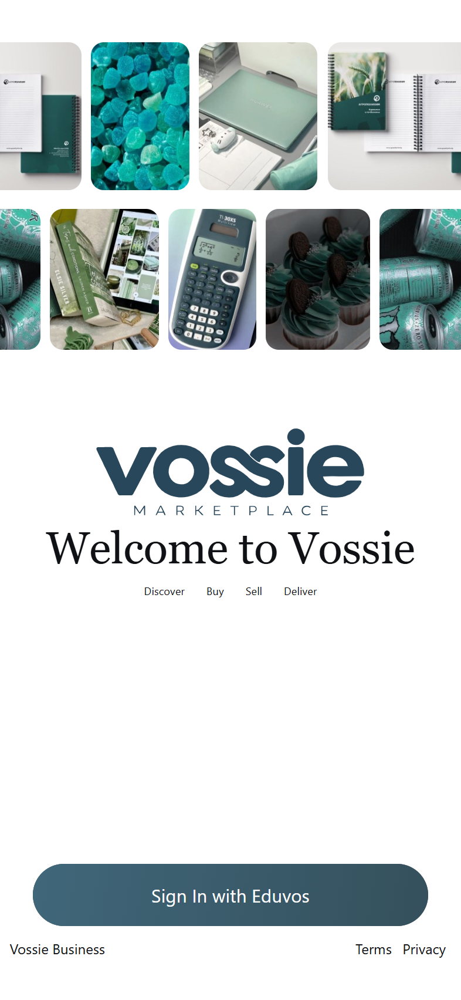
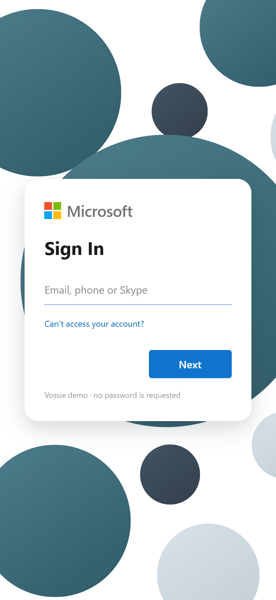
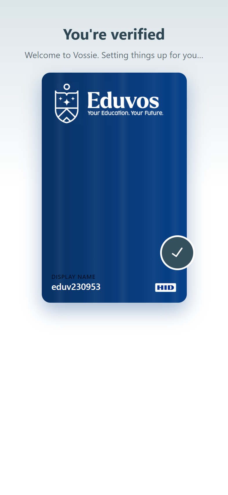

<div align="center">

# Vossie Marketplace

### Buy. Sell. Deliver. The campus marketplace for Eduvos students.

One app for iPhone, Android and the web, with three modes: **Buyer**, **Seller** and **Courier**.

[](https://vossie-marketplace.vercel.app)
[](docs/DEMO-TO-REAL.md)
[](LICENSE)

<br />

<a href="docs/media/vossie-launch.mp4">
  
</a>

**[▶ Watch the launch film](docs/media/vossie-launch.mp4)**

</div>

<br />

## Getting in

<table>
  <tr>
    <td align="center"></td>
    <td align="center"></td>
    <td align="center"></td>
    <td align="center"></td>
  </tr>
  <tr>
    <td align="center"><b>Intro</b><br />Animated wordmark</td>
    <td align="center"><b>Welcome</b><br />Animated gallery</td>
    <td align="center"><b>Sign in</b><br />Microsoft account</td>
    <td align="center"><b>Verified</b><br />Student card</td>
  </tr>
</table>

## What it does

| Mode | What you can do |
| --- | --- |
| **Buyer** | Browse by category, search, watch Reels, view listings, add to cart, check out with card or voucher, track orders and bookings, manage wallet, inbox and security. |
| **Seller** | Set up a store, list products, manage stock, receive and fulfil orders, hand over with a code, see earnings and payouts. |
| **Courier** | Set up availability, take delivery jobs, run an active delivery, track earnings. |

Money is handled as integer ZAR cents throughout.

> **Working prototype.** The full experience is built and runs on demo data. The Supabase backend is designed, tested and live, but payments, real sign-in and verification are not connected yet. See [what is still demo](docs/DEMO-TO-REAL.md).

## Tech stack

**App**


**Backend**


**Build, test and ship**


## Getting started

```bash
npm ci
cp .env.example .env.local   # add your own Supabase values
npm run web                  # open the Metro URL in Chrome
```

```bash
npm run start:go             # iPhone with Expo Go on the same network
npm run start:dev-client     # an installed Vossie development build
```

Out of the box the app runs on in-memory demo data, so it works without a backend. Set `EXPO_PUBLIC_USE_BACKEND=true` to use Supabase.

**Demo sign-in:** `eduv230953@vossie.net` is a returning user. Any other email starts profile setup. Voucher codes: `VOSSIE10`, `WELCOME20`.

## Checks

```bash
npm run verify      # lint, typecheck, unit tests, web export
npm run test:db     # database and row-level security tests
```

## Project layout

| Path | Purpose |
| --- | --- |
| `src/app/` | Expo Router routes: tabs, seller, courier and onboarding flows |
| `src/screens/`, `src/components/` | Screens and shared UI |
| `src/seller/`, `src/courier/` | Seller and courier modes |
| `src/services/`, `src/backend/` | Typed service layer over Supabase |
| `src/theme/` | Design tokens |
| `supabase/` | Migrations, Edge Functions, seed data and database tests |
| `design/` | Design system, reference screens and tokens |
| `docs/` | Architecture, product, security and decision records |
| `promo-video/` | Source for the launch film |

## Documentation

- [Backend architecture](docs/architecture/backend.md)
- [Screens built](docs/product/screens-built.md)
- [Design system](design/README.md)
- [What is still demo](docs/DEMO-TO-REAL.md)
- [Documentation index](docs/INDEX.md)

## Engineering workflow

The repository also carries an AI-agent engineering runtime ([`AGENTS.md`](AGENTS.md), [`AGENT-CONTRACTS.md`](AGENT-CONTRACTS.md), `.vossie/`, `.cursor/`). Contributors working by hand can ignore it.

## Contributing

Open a pull request using the [template](.github/PULL_REQUEST_TEMPLATE.md). Run `npm run verify` first.

## License

Copyright © 2026 Vossie Marketplace. All rights reserved. See [LICENSE](LICENSE).
