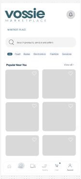
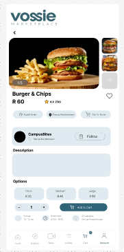
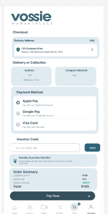
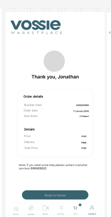

# Vossie Marketplace

**The campus marketplace for Eduvos students.** Buy, sell and deliver on campus, in one app, for iPhone, Android and the web.

**Live demo:** <https://vossie-marketplace.vercel.app>

> **Status: working prototype.** The full buyer, seller and courier experience is built and runs on demo data. The Supabase backend is designed, tested and live, but payments, real sign-in and verification are not connected yet. See [what is still demo](docs/DEMO-TO-REAL.md).

<p>
  
  
  
  
  
</p>

## What it does

Three modes in one app, switched from the account tab:

| Mode | What you can do |
| --- | --- |
| **Buyer** | Browse by category, search, watch Reels, view listings, add to cart, check out with card or voucher, track orders and bookings, manage wallet, inbox and security. |
| **Seller** | Set up a store, list products, manage stock, receive and fulfil orders, hand over with a code, see earnings and payouts. |
| **Courier** | Set up availability, take delivery jobs, run an active delivery, track earnings. |

Money is handled as integer ZAR cents throughout.

## Tech stack

- **App:** Expo 57, React Native, Expo Router, TypeScript (universal: iOS, Android, web)
- **Backend:** Supabase (Postgres with row-level security, Auth, Storage, Realtime, Edge Functions)
- **Hosting:** Vercel (web export), EAS (native builds)
- **Tests:** Jest for the app, Node test runner with PGlite for the database

## Getting started

```bash
npm ci
cp .env.example .env.local   # add your own Supabase values
npm run web                  # open the Metro URL in Chrome
```

Other ways to run it:

```bash
npm run start:go             # iPhone with Expo Go on the same network
npm run start:dev-client     # an installed Vossie development build
```

Out of the box the app runs on in-memory demo data, so it works without any backend. Set `EXPO_PUBLIC_USE_BACKEND=true` to use Supabase.

Demo sign-in: `eduv230953@vossie.net` is a returning user. Any other email starts profile setup. Voucher codes: `VOSSIE10`, `WELCOME20`.

## Checks

```bash
npm run verify      # lint, typecheck, unit tests, web export
npm run test:db     # database and row-level security tests
```

## Project layout

| Path | Purpose |
| --- | --- |
| `src/app/` | Expo Router routes: tabs, seller, courier and onboarding flows |
| `src/screens/`, `src/components/` | Screens and shared UI |
| `src/seller/`, `src/courier/` | Seller and courier modes |
| `src/services/`, `src/backend/` | Typed service layer over Supabase |
| `src/theme/` | Design tokens |
| `supabase/` | Migrations, Edge Functions, seed data and database tests |
| `design/` | Design system, reference screens and tokens |
| `docs/` | Architecture, product, security and decision records |
| `promo-video/` | Source for the launch film |

## Documentation

- [Backend architecture](docs/architecture/backend.md)
- [Screens built](docs/product/screens-built.md)
- [Design system](design/README.md)
- [What is still demo](docs/DEMO-TO-REAL.md)
- [Documentation index](docs/INDEX.md)

## Engineering workflow

The repository also carries an AI-agent engineering runtime ([`AGENTS.md`](AGENTS.md), [`AGENT-CONTRACTS.md`](AGENT-CONTRACTS.md), `.vossie/`, `.cursor/`, `.codex/`). Contributors working by hand can ignore it.

## Contributing

Open a pull request using the [template](.github/PULL_REQUEST_TEMPLATE.md). Run `npm run verify` first.
