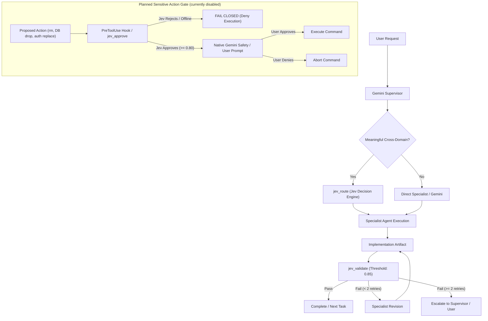

# Vossie Jev Decision Layer Architecture

Production-grade decision intelligence integration for Gemini CLI and Antigravity.

---

## 1. Executive Architecture



### Roles
- **Gemini CLI / Antigravity**: Primary generative reasoning, complex code generation, refactoring, tool invocation, and multi-agent coordination engine.
- **Jev (TypeSafe AI System One)**: Low-latency, deterministic, typed decision intelligence engine providing objective probabilities, routing choices, approval gating, and validation.

---

## 2. MCP Tools Overview

The local MCP server is located at `.gemini/jev-mcp/` and communicates via Stdio JSON-RPC:

| MCP Tool | Purpose | Schema Inputs | Key Outputs |
| :--- | :--- | :--- | :--- |
| **`jev_route`** | Evaluates task against candidate agents | `task`, `candidates`, `context?`, `instructions?`, `model?` | `selected`, `confidence`, `probabilities`, `lowConfidence` |
| **`jev_approve`** | Evaluates sensitive actions (strict fail-closed) | `action`, `context?`, `risk?`, `threshold?` (0.80), `instructions?` | `approved`, `confidence`, `threshold`, `reason` |
| **`jev_validate`** | Evaluates output against requirements | `task`, `result`, `requirements`, `threshold?` (0.85), `instructions?` | `valid`, `confidence`, `failedRequirements`, `reason` |
| **`jev_score`** | Multi-criteria scoring | `subject`, `criteria`, `instructions?` | `scores`, `overallScore`, `model` |
| **`jev_models`** | Inspects available Jev models | (None) | `models` |

---

## 3. Specialist Agent Roster

1. **`supervisor`**: Orchestration, task decomposition, Jev decision routing, escalation handling.
2. **`architecture`**: Modular application architecture, dependency boundaries, package relationships, ADRs.
3. **`frontend_ui`**: Responsive UI (mobile, tablet, desktop), components, Tailwind, design tokens, a11y, microinteractions.
4. **`backend`**: Next.js server actions, APIs, database schemas/migrations, transactional integrity, queues.
5. **`authentication`**: Eduvos/Microsoft SSO, OAuth/OIDC, student verification redirects, sessions, RBAC.
6. **`marketplace`**: Buyer/Seller/Courier workflows, listings, carts, checkout, reels, offers, ratings.
7. **`operations`**: Vossie Operations app, Campus Hub logistics, package transfers, incubation, staff dashboards.
8. **`security`**: Threat modeling, authorization boundaries, secrets hygiene, input sanitization, POPIA compliance.
9. **`qa`**: Automated unit, integration, and E2E test suites, regression testing, performance benchmarking.

---

## 4. Decision & Routing Policies

### Routing Policy
- Evaluates tasks spanning multiple domains using `jev_route`.
- **Low Confidence Threshold**: If confidence is below `0.65`, the supervisor does not blindly trust the result; it inspects candidate probabilities and chooses conservatively.
- **Offline / Unavailable Fallback**: Non-sensitive tasks fall back to conservative domain heuristics, logging that Jev was unavailable.

### Approval Policy (Strict Fail-Closed)
- Default approval confidence threshold: **`0.80`**.
- Any network failure, rate limit, missing key, or confidence < 0.80 immediately triggers **FAIL CLOSED (`approved: false`)**.
- Triple safety requirement: Jev approval + native Gemini CLI safety check + explicit user confirmation must all be satisfied.

### Validation & Retry Loop Policy
- Default validation confidence threshold: **`0.85`**.
- Maximum automatic specialist revisions: **2 retries**.
- If work fails validation twice, the loop breaks and escalates to the supervisor or user with diagnostic reasons.

---

## 5. Hook Integration Status

The hook interceptor code and tests exist, but automatic enforcement is not active. `.agents/hooks.json` has `enabled: false`, and `.gemini/settings.json` registers the MCP server without a `PreToolUse` hook. No command interception or automatic denial should be inferred from the tested interceptor code. The host's native safety controls still apply; `jev_approve` may be invoked deliberately. Enabling a hook requires supported host registration and an end-to-end check before documenting enforcement.

---

## 6. Environment Setup & Configuration

### Required Credential
- Environment Variable: `JEV_API_KEY` (or `TYPESAFE_API_KEY`)
- Set in current PowerShell session:
  ```powershell
  $env:JEV_API_KEY="your-typesafe-api-key"
  ```
- Set persistently in Windows:
  ```powershell
  [Environment]::SetEnvironmentVariable("JEV_API_KEY", "your-typesafe-api-key", "User")
  ```

### Verification & Testing
Inside `.gemini/jev-mcp`:
```powershell
npm install
npm run build
npm test
```

The MCP server uses a repository-relative path. Build output is written to `.gemini/jev-mcp/dist/` and is ignored by Git. The hook is not registered.

From an already-running Gemini CLI session, reload the MCP configuration after building or changing `.gemini/settings.json`:

```text
/mcp reload
```

If reload is unavailable, restart the Gemini CLI session.

---

## 7. Current Disabled State and Fallback

`.agents/hooks.json` already sets `enabled: false`; changing that flag alone does not register a host hook. If `JEV_API_KEY` is unset or Jev is unreachable, the MCP tools return their documented conservative fallback or failure result. Ordinary commands are not gated by Jev in the current configuration.

---

## 8. Security Considerations

- `JEV_API_KEY` is never logged or exposed in outputs; automatic regex redaction strips keys from diagnostics.
- Secrets are excluded via `.gitignore` (`.env`, `credentials.json`, `*.key`).
- Diagnostics are strictly output to `stderr`, protecting MCP JSON-RPC protocol messages on `stdout`.
